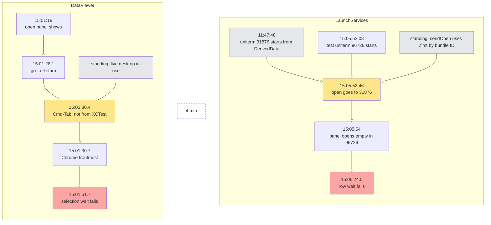

# Two UI test failures in the 2026-11-26 baseline came from the shared desktop
<!-- session-report owner: ses_de5d5839cffefj1IAhnUQwGNDk -->

Date: 2026-11-26. Trigger: a baseline report that read "`make test` failed 2 of 213 UI tests and passed everything
else." The two failures were `LaunchServicesOpenUITests.testADeniedOpenFromAnotherProgramOpensNothingAndSaysSo` and
`DataViewerUITests.testLauncherOpensAnEmptyViewerAndItsOpenButtonLoadsAFile`. Both passed when run alone.

All observations come from one machine: a MacBook Pro on macOS 26.7.3 (build 25G342). The UI tests ran in the
logged-in user's own desktop session. Source references are pinned to commit
[28cd2f0](https://github.com/ripta/uniterm/commit/28cd2f0ae602d2468f274d3da3893bcd59437c40), the head at the time of
the analysis.

## Verdict

Neither failure is a uniterm bug. Both came from activity in the desktop session the suite shared. Each test also
lacks a guard that would catch that activity.

| Failure | Cause | Status |
| --- | --- | --- |
| LaunchServices, "the question never reached the panel" | The test's open request went to a second uniterm instance. That instance had been started separately at 11:47 from the regular build folder. | Confirmed. Not fixed. |
| DataViewer, "the panel never selected sales.csv" | Two Cmd-Tab presses that XCTest did not send moved the focus from uniterm to Chrome while the system's open panel showed. | Confirmed that the presses came from outside XCTest. Likely that they caused the failure. Not fixed. |

The LaunchServices cause is deterministic. Any run while a regular uniterm build is open fails that test. The sibling
test `testAnOpenFromAnotherProgramWaitsForTheUserThenOpensBesideTheFocusedPane` has the same exposure.

## Terms

- Kept log: the gzipped `log show` output that `scripts/run-ui-tests.sh` keeps after a failed UI run, at
  `.build/DerivedData-test/ui-test-kept-log.txt.gz`. It holds `testmanagerd` lines, the test runner's marks, and the
  app's input records. UTERM-060 added it.
- Frontmost record: an attachment that `UnitermUITestCase` keeps on a failing test. It lists the frontmost app at
  test start and every activation after it.
- `testmanagerd`: Apple's daemon that synthesizes XCTest's input events and tracks the target app.
- Pending Requests panel: uniterm's window where a user answers a question, such as whether to allow an open that
  another program sent.

## Prerequisites to reproduce the evidence

- The failed run's result bundle:
  `.build/DerivedData-test/Logs/Test/Test-uniterm-2026.11.26_14-57-33--0800.xcresult`.
- The rerun's result bundle: `.build/DerivedData-test/Logs/Test/20261126-151705-15787.xcresult`.
- The kept log: `.build/DerivedData-test/ui-test-kept-log.txt.gz`.
- The machine's unified log store, still holding 2026-11-26. Use `/usr/bin/log`, because zsh has a `log` builtin.
- Xcode command line tools for `xcrun xcresulttool`.

These files are local and not committed. The quoted output below stands in for them once they are gone.

## Run timeline

All times are local Pacific time on 2026-11-26.

- 11:47:48. A uniterm with pid 31876 starts from `.build/DerivedData/Build/Products/Debug/uniterm.app`. It was not
  launched through Launch Services. It has a browser pane open.
- 14:57:33. `make test` starts the UI suite. The test app is built in `.build/DerivedData-test`.
- 15:01:16 to 15:01:52. The DataViewer test runs and fails.
- 15:05:51 to 15:06:25. The LaunchServices test runs and fails.
- 15:16:35. The suite ends with 211 passed and 2 failed.
- 15:17:05. Both tests are rerun alone and pass.

## Finding 1: the LaunchServices open went to another uniterm

### Evidence

Step 1. The result summary names the failure.

```sh
xcrun xcresulttool get test-results summary \
  --path .build/DerivedData-test/Logs/Test/Test-uniterm-2026.11.26_14-57-33--0800.xcresult
```

```text
"failedTests" : 2,
"passedTests" : 211,
"failureText" : "XCTAssertTrue failed - the question never reached the panel",
"testIdentifierString" : "LaunchServicesOpenUITests/testADeniedOpenFromAnotherProgramOpensNothingAndSaysSo()",
```

Step 2. The frontmost record shows two uniterm pids. Export the attachments, then read the record for this test.

```sh
xcrun xcresulttool export attachments \
  --path .build/DerivedData-test/Logs/Test/Test-uniterm-2026.11.26_14-57-33--0800.xcresult \
  --output-path /tmp/rca-attachments
```

The record's file was `3211AC4E-6407-4174-9AEF-6AD794159C80.txt`. `manifest.json` in the output folder maps it to
the test.

```text
At test start: WezTerm (com.github.wez.wezterm, pid 1289)
Activation at 817427152.088835: uniterm (dev.uniterm.app, pid 96726)
Activation at 817427152.464576: uniterm (dev.uniterm.app, pid 31876)
Activation at 817427152.547977: uniterm (dev.uniterm.app, pid 96726)
Activation at 817427180.331128: uniterm (dev.uniterm.app, pid 31876)
Activation at 817427181.665135: uniterm (dev.uniterm.app, pid 96726)
```

The timestamps count seconds from 2001-01-01 UTC. 817427152 is 15:05:52, and 817427180 is 15:06:20.

Step 3. `testmanagerd` names each pid's bundle path.

```sh
gzcat .build/DerivedData-test/ui-test-kept-log.txt.gz | grep -E "pid: (31876|96726) state" | head -4
```

```text
15:05:52.075 … dev.uniterm.app@/Users/ripta/projects/uniterm/.build/DerivedData-test/Build/Products/Debug/uniterm.app processName: uniterm pid: 96726 state: running background
15:05:52.474 … dev.uniterm.app@/Users/ripta/projects/uniterm/.build/DerivedData/Build/Products/Debug/uniterm.app processName: uniterm pid: 31876 state: running foreground
```

So pid 96726 is the app the test launched. Pid 31876 is a build from the regular `DerivedData` folder with the same
bundle identifier.

Step 4. Pid 31876 was started hours before the run.

```sh
/usr/bin/log show --start "2026-11-26 09:00:00" --end "2026-11-26 14:58:00" --style compact \
  --predicate 'processIdentifier == 31876' | grep BringForward
```

```text
2026-11-26 11:47:48.994 Df uniterm[31876:e69fe5] [com.apple.processmanager:front-35286506] BringForward: pid=31876 asn=0x0-0x465a656 bringForward=0 foreground=1 uiElement=0 launchedByLS=0 modifiersCount=0 allDisabled=0
```

Its WebKit helpers had pids 31881, 31882, and 31899. They died with it at 15:06:21.

Step 5. Pid 31876 handled an incoming open at 15:05:52.

```sh
/usr/bin/log show --start "2026-11-26 15:05:52" --end "2026-11-26 15:06:22" --style compact \
  --predicate 'processIdentifier == 31876' | grep -v mouseMoved
```

```text
15:05:52.456 A  uniterm[31876] (RunningBoardServices) didChangeInheritances
15:05:52.503 A  uniterm[31876] (CoreServicesInternal) CFURLResolveBookmarkData
15:05:52.508 A  uniterm[31876] (Security) SecKeyVerifySignature
15:05:52.509 A  uniterm[31876] (Security) SecTrustEvaluateIfNecessary
…
15:06:21.376 A  uniterm[31876] (AppKit) perform action for menu item
15:06:21.377 Df uniterm[31876] [com.apple.AppKit:Application] terminate:
```

Resolving a file bookmark and checking a signature is what uniterm does when it checks the sender of an open request.
`LaunchOpenCoordinator` logs its decision at info level, which the log store does not keep. So the question's arrival
in 31876 is inferred, not logged. At 15:06:21 someone quit 31876 from a menu item or its key equivalent.

Step 6. The test's own app opened the panel and got nothing.

```sh
gzcat .build/DerivedData-test/ui-test-kept-log.txt.gz | grep -E "uniterm\[96726:" | grep -v mouseMoved
```

```text
15:05:53.683 … type=leftMouseDown … event_window=53734
15:05:54.072 … window_became_key at=817427154.075658 window=53737
15:06:20.110 … window_resigned_key at=817427180.119197 window=53737
```

Window 53737 is the Pending Requests panel. It opened at 15:05:54. The 30 s wait for a row ran out at 15:06:24.48,
as the runner's issue mark shows.

Step 7. The test picks its target by bundle identifier
([LaunchServicesOpenUITests.swift:29-44](https://github.com/ripta/uniterm/blob/28cd2f0ae602d2468f274d3da3893bcd59437c40/UITests/LaunchServicesOpenUITests.swift#L29-L44)).

```swift
let running = try XCTUnwrap(
  NSRunningApplication.runningApplications(withBundleIdentifier: "dev.uniterm.app").first)
let appURL = try XCTUnwrap(running.bundleURL)
…
NSWorkspace.shared.open(
  [folder], withApplicationAt: appURL, configuration: NSWorkspace.OpenConfiguration()
)
```

With two instances running, `.first` returned 31876. Its `bundleURL` is the regular build's path. Launch Services
therefore delivered the open to the instance running from that path. This code dates from
[0156da2](https://github.com/ripta/uniterm/commit/0156da2), "Ask before opening files that other apps send", on
2026-11-17.

### Causal chain

- The question never reached pid 96726's panel.
- Because the open request went to pid 31876. Confirmed by steps 3, 5, and 6.
- Because `sendOpen` takes the first running `dev.uniterm.app` and opens with its bundle URL. Confirmed by step 7.
- Two conditions were both needed:
  - A second `dev.uniterm.app` was running. Confirmed by steps 3 and 4. Nothing checks for an existing uniterm
    before a UI run, and nothing ends one. The regular build shares the test build's bundle identifier.
  - `.first` is not tied to the process the test launched. Confirmed by step 7. The order of `runningApplications`
    is not documented. That the oldest instance comes first is inferred from this one run.

## Finding 2: Cmd-Tab from outside XCTest moved the focus to Chrome

### Evidence

Step 1. The failure message names Chrome.

```text
XCTAssertTrue failed - the panel never selected sales.csv. The app is in the background. The frontmost app is
Google Chrome (com.google.Chrome, pid 1291). In the app, 'data-viewer' has keyboard focus.
```

The assertion is at
[UnitermUITestCase.swift:546-547](https://github.com/ripta/uniterm/blob/28cd2f0ae602d2468f274d3da3893bcd59437c40/UITests/UnitermUITestCase.swift#L546-L547),
inside `chooseInSystemPanel`. It waits 20 s for the chosen file's row to show as selected in the system's open panel.

Step 2. The frontmost record for this test, from `F691D664-8082-441A-B1CF-5F967C6BA1A5.txt`:

```text
At test start: Google Chrome (com.google.Chrome, pid 1291)
Activation at 817426876.391277: uniterm (dev.uniterm.app, pid 89970)
Activation at 817426890.708409: Google Chrome (com.google.Chrome, pid 1291)
Activation at 817426901.044265: uniterm (dev.uniterm.app, pid 89970)
Activation at 817426906.31366: Google Chrome (com.google.Chrome, pid 1291)
Activation at 817426909.848892: Finder (com.apple.finder, pid 1301)
Activation at 817426911.02174: Google Chrome (com.google.Chrome, pid 1291)
```

These are 15:01:16, 15:01:30.7, 15:01:41, 15:01:46.3, 15:01:49.8, and 15:01:51.0.

Step 3. The test's gestures, as `testmanagerd` logged them.

```sh
gzcat .build/DerivedData-test/ui-test-kept-log.txt.gz \
  | awk '$2>="15:01:24.0" && $2<="15:01:52.0"' | grep -E "Finished Type"
```

```text
15:01:24.069 … Finished Type 'g' key with modifiers '⌘⇧' (0x12)
15:01:27.228 … Finished Type '/Users/ripta/Library...'
15:01:28.138 … Finished Type '↩' key (XCUIKeyboardKeyReturn)
```

XCTest sent no input after 15:01:28.138 until the failure.

Step 4. WindowServer saw two Cmd-Tab presses after that.

```sh
/usr/bin/log show --start "2026-11-26 15:01:28" --end "2026-11-26 15:01:52" --style compact \
  --predicate '(eventMessage CONTAINS "specialkey") OR (eventMessage CONTAINS "SETFRONT")'
```

```text
15:01:30.424 WindowServer … processHotKeyEvent: frontmost process uniterm allows special key appSwitchFWD, so entering special key mode
15:01:30.723 launchservicesd … SETFRONT: pid=1291 … oldFrontPid=89970
15:01:40.326 WindowServer … processHotKeyEvent: frontmost process Google Chrome allows special key appSwitchFWD, so entering special key mode
15:01:41.058 launchservicesd … SETFRONT: pid=89970 … oldFrontPid=1291
15:01:46.328 launchservicesd … SETFRONT: pid=1291 … oldFrontPid=89970
15:01:49.623 launchservicesd … SETFRONT: pid=1301 … oldFrontPid=1291
15:01:50.977 launchservicesd … SETFRONT: pid=1291 … oldFrontPid=1301
```

`appSwitchFWD` is the Cmd-Tab app switcher. The changes at 15:01:46 and later have no hot key line, so they came
from something else, such as a click.

Step 5. The desktop was in use during the run. Over the whole run, the frontmost app at test start was Chrome for 47
tests and WezTerm for 166. The switch from Chrome to WezTerm came near 15:02:27.

```sh
gzcat .build/DerivedData-test/ui-test-kept-log.txt.gz | grep "uitests:frontmost\] At test start" \
  | grep -oE "start: [A-Za-z ]+" | sort | uniq -c
```

```text
  47 start: Google Chrome
 166 start: WezTerm
```

### Causal chain

- The selection wait failed with Chrome frontmost.
- Because uniterm lost the front while the system's open panel showed. Confirmed by step 4, at 15:01:30.723.
- Because a Cmd-Tab arrived at 15:01:30.424, and another at 15:01:40.326. Confirmed by step 4.
- Because the presses came from outside XCTest. Confirmed by step 3.
- Because the local suite runs in the user's live desktop session, which was in use. Nothing stops outside input,
  and nothing flags it during the run. The Makefile's help only says "a local run needs the pointer and keyboard left
  alone."

That losing the front caused the missed selection is likely, not proven. The go-to sheet closed at about 15:01:28.1.
The Cmd-Tab came 2.3 s later. Each accessibility query costs 1.5 to 5 s while the panel shows, so the wait had made at
most one query before the switch. The test passed alone at 15:17, and every other open-panel test passed in this run.

## Contributing factors

- The system's open panel runs in another process. Every accessibility query costs 1.5 to 5 s while it shows. The
  20 s wait therefore holds only a few attempts. `spec/flaky-tests.md` records this cost under the go-to field entry.
- A similar failure was seen before. On 2026-11-22, the same DataViewer test failed with Apple's TV app frontmost.
  The TV app had started from outside the run. `spec/flaky-tests.md` records it under
  `MapViewerUITests.testTheStyleSurvivesARelaunchAndAnUnknownStyleShowsStandard`, with the cause unconfirmed.

## Ruled out

- A leftover app from the previous test caused the LaunchServices failure. Ruled out: pid 31876 started at 11:47:48,
  about three hours before the run, from `DerivedData`, not `DerivedData-test`.
- XCTest sent the Cmd-Tab. Ruled out: `testmanagerd` logged no gesture between 15:01:28.138 and the failure.
- A uniterm bug in handling opens or in the panel. Ruled out: both tests passed in the 15:17 rerun, with no second
  instance and no outside input. The sibling LaunchServices test passed at 15:06:25 to 15:06:31, after 31876 quit.

## Open questions

- Who pressed Cmd-Tab and quit 31876. It may have been a person or a computer-use agent. Needs: an account from
  whoever had the desk.
- Whether `runningApplications` always lists the oldest instance first. Needs: a run with two instances that logs the
  full list.
- Whether the panel would have selected the file had uniterm stayed in front. Needs: a run that sends Cmd-Tab at the
  same point on purpose.

## Causal chart



## Remediation options

For the LaunchServices tests, either option closes the cause. They can also be combined.

- Pick the instance the test launched. Filter `runningApplications` by a `bundleURL` that matches the app under
  test, or take the newest launch date. This is small and local to the test file. It leaves a stray instance free to
  disturb other tests, such as by taking the front.
- Have `scripts/run-ui-tests.sh` refuse to start, or warn, when a `dev.uniterm.app` is already running. This
  protects every test. Refusing is safer, but it blocks a run until the developer quits their own uniterm. Ending the
  instance automatically would lose the developer's work, so it is not offered.

For the DataViewer test, outside input cannot be prevented from inside the test.

- Fail fast with a clear message when another app takes the front during a test. The frontmost observer already sees
  every activation. This turns a 20 s timeout into an immediate, named failure. It does not make the run pass.
- Keep running the full suite only on an idle desktop, or on CI. This is the existing guidance.

## Status

Analysis only. No code or tests were changed. Both causes remain open, and no remediation was chosen.
